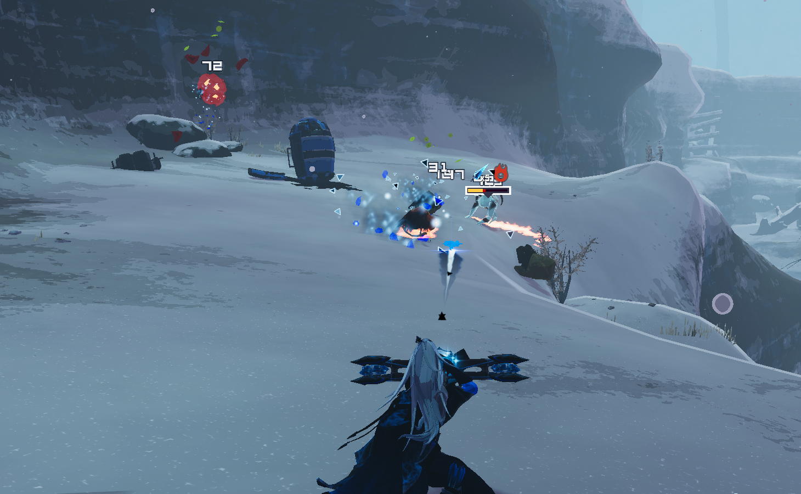
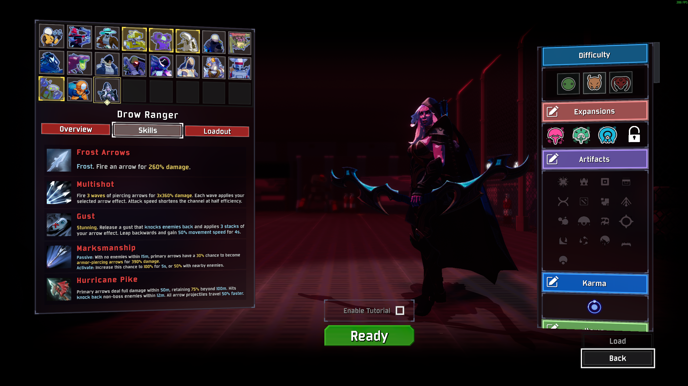
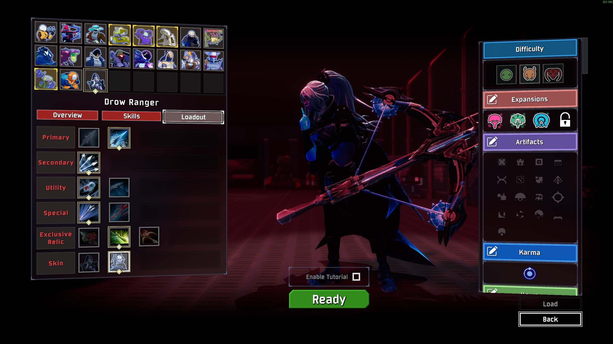

# Drow Ranger

Bring the frost archer of Dota 2 to Petrichor V.

Drow Ranger is a ranged survivor built around spacing, deliberate shots, and punishing enemies before they can close in. Slow a dangerous target with Frost Arrows, turn a crowd into a chain of ice explosions with Hypothermia, or line up an armor-piercing shot to break through tougher defenses.

- Adds Drow Ranger as a separate playable survivor.
- Includes the classic appearance and **Dread Retribution** Arcana skin, each with its own Dota selection animation and presentation.
- Choose between **three exclusive relics** and alternate primary, utility, and special skills.
- Features Dota-derived models, animations, weapon and skill sounds, plus effects adapted for Risk of Rain 2.
- Includes **English and Simplified Chinese** in-game text. Arcana dialogue is disabled; combat sound effects remain.

## Overview

Keep enemies at a distance to get the most out of Marksmanship. Your arrows have travel time, so lead moving targets and watch your range. Gust creates room to retreat, while Glacier raises a temporary perch above the fight.

Choose Frost Arrows for stacking slows or Hypothermia for death-triggered explosions. Multishot, Gust, and Winter Strike apply your selected arrow effect, letting you build around control or chain reactions.

## Skills

Values below use the default configuration. Cooldowns are base values before item modifiers.

| Slot | Skill | Description | Cooldown |
| --- | --- | --- | --- |
| Primary | **Frost Arrows** | Fire an arrow for **260% damage**, applying a stack of Frost. | — |
| Primary | **Hypothermia** | Fire an arrow for **260% damage**, applying Hypothermia. Afflicted enemies explode on death. | — |
| Secondary | **Multishot** | Fire **3 waves** of piercing arrows for **3 × 360% damage**. Each wave applies your selected arrow effect. Attack speed shortens the channel at half efficiency. | 9s |
| Utility | **Gust** | Release a stunning gust that knocks enemies back and applies **3 stacks** of your arrow effect. Leap backward and gain **50% movement speed for 4s**. | 8s |
| Utility | **Glacier** | Raise a glacier beneath you, lifting you to its summit and knocking nearby enemies back. Lasts **8s**. | 16s |
| Special | **Marksmanship** | With no enemies within **15m**, primary attacks have a **30% chance** to fire an armor-piercing arrow for **390% damage**. Activate to raise the chance to **100% for 5s**, or **50%** while enemies are nearby. | 25s |
| Special | **Winter Strike** | Wind up, then fire an armor-piercing arrow for **1600% damage**, piercing up to **5 enemies** and applying **10 stacks** of your arrow effect. The windup cannot be cancelled voluntarily. | 10s |

### Arrow effects

**Frost:** Each stack reduces remaining movement speed by **15%** for **3s**, up to **10 stacks**. Hits refresh the duration. Frost slows enemies without completely freezing them; control effects respect applicable native immunities.

**Hypothermia:** Lasts **7s**, up to **10 stacks**. On death, the target explodes for **150%–600% damage** in a **2–12m radius**, depending on stacks. Explosions spread Hypothermia and can trigger further explosions. Hypothermia does not slow enemies.

**Armor-piercing:** Ignores positive armor, can critically strike, and retains your selected arrow effect. Marksmanship rolls when the arrow is fired and is unaffected by luck.

**Range:** Primary attacks deal full damage within **40m**, with linear falloff to **60% damage at 80m**. Damage remains at that minimum beyond 80m; arrows do not disappear at the falloff endpoint.

## Exclusive Relics

Choose one relic in the loadout menu. Relics are passive choices and do not occupy your equipment slot.

| Relic | Effect |
| --- | --- |
| **Hurricane Pike** | Primary attacks deal full damage within **50m**, retaining **75% damage at 100m and beyond**. Hits knock back non-boss enemies within **12m**. All arrow projectiles travel **50% faster**. |
| **Butterfly** | Gain **20% attack speed** and a **30% chance to block damage**. Stacks with Tougher Times with diminishing returns. |
| **Daedalus** | Gain **30% critical strike chance**. Critical strikes deal **225% damage**, before other critical damage bonuses. |

## Skins

**Drow Ranger** — The classic bow, hood, and cloak, with a landing entrance that flows into her Dota display idle.

**Dread Retribution** — The Arcana appearance, crossbow, matching arrow and skill presentation, and a full turn-and-draw selection animation.

Both skins and all loadout choices are available immediately.

## Multiplayer and Configuration

**All players must have this mod enabled at the same version.** Disable it before joining players who do not have it. Multiplayer edge cases still need broader testing.

Configuration is stored in `BepInEx/config/DrowRanger.cfg`, created on first launch. Previous DotaHero configuration files are no longer used. Settings include Dota sound volume, model scale, primary and Multishot damage, Gust range, and armor-piercing arrow damage. Use matching gameplay settings across clients and restart the game after editing.

With **LookingGlass** installed, skill tooltips include proc coefficients and notes for empowered arrows, Multishot hits, and Hypothermia explosions. LookingGlass is optional.

## Feedback

When reporting an issue, include the mod version, selected skin and loadout, other installed mods, and whether you were hosting or joining. A short reproduction sequence and `BepInEx/LogOutput.log` are especially helpful. For terrain or animation issues, include a screenshot or short clip.

## AI Disclosure

AI tools assisted with code, documentation, and some UI icon artwork. Gameplay design, review, and in-game testing were directed by the author. The images above are actual gameplay screenshots; the combat image is cropped. Dota character assets originate from Valve.

## Credits

- **DDL** — Mod author, gameplay design, testing, and Chinese text.
- **Valve / Dota 2** — Drow Ranger and Dread Retribution character assets, animations, source effects, icons, and audio.
- **HenryTutorial contributors** — Survivor template and project foundation.
- **BepInEx and R2API contributors** — Mod loading and survivor integration tools.
- **ValveResourceFormat / Source 2 Viewer contributors** — Source asset inspection and extraction tools.

This is a community-made adaptation of Drow Ranger for Risk of Rain 2. Character assets belong to their respective creators. Some Source 2 effects are recreated in Unity to fit the game.
